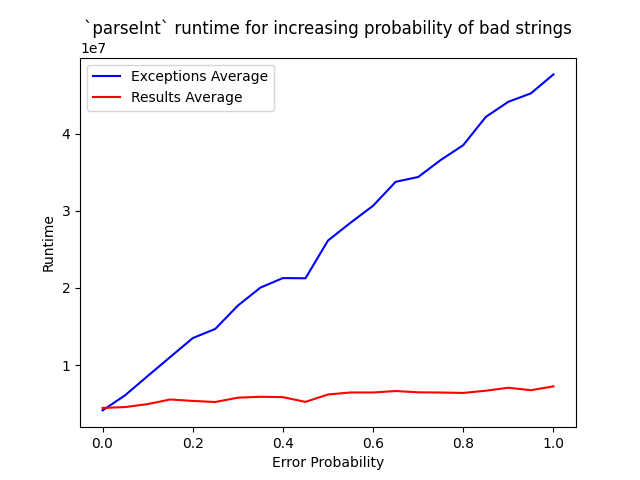

```
      ███                                    ███    ██████             ███  
     ░░░                                    ███    ███░░███           ░░███ 
     █████  ██████   █████ █████  ██████   ███    ░███ ░░░  ████████   ░░███
    ░░███  ░░░░░███ ░░███ ░░███  ░░░░░███ ░███   ███████   ░░███░░███   ░███
     ░███   ███████  ░███  ░███   ███████ ░███  ░░░███░     ░███ ░███   ░███
     ░███  ███░░███  ░░███ ███   ███░░███ ░░███   ░███      ░███ ░███   ███ 
     ░███ ░░████████  ░░█████   ░░████████ ░░███  █████     ████ █████ ██░  
     ░███  ░░░░░░░░    ░░░░░     ░░░░░░░░   ░░░  ░░░░░     ░░░░ ░░░░░ ░░░   
 ███ ░███                                                                   
░░██████                                                                    
 ░░░░░░                                                                     
```

`java(fn)` is a lightweight library (on the order of hundreds of kb) with no dependencies, which adds a few additional functional tools to the java language, most notably a `Result` class for error handling without exceptions.

## Result and Either

The `Result` class is an algebraic type that represents the possibly unsuccessful result of an operation.  Similar to an `Either` in many languages, a `Result` wraps a value of type ERR or of type OK, but never both.  `null` is a valid Ok value, similar to `Optional.empty()`, but the error type will always be non-null.

```java
final String theUrl = "http://localhost:8080/example";
Result.ok(theUrl)
     .flatMap(Try.toMap(URL::new))
     .flatMap(Try.toMap(URL::openConnection))
     .flatMap(Try.toMap(URLConnection::getInputStream))
     .map(is -> new BufferedReader(new InputStreamReader(is)))
     .map(BufferedReader::lines)
     .ifErr(ex -> System.err.println("An exception occurred trying to fetch the url.  " + ex.message()))
     .ifOk(lines -> System.out.println("URL contents from demoResult: "
             + lines.collect(Collectors.joining("\n"))));
```

See more demo code [in the source tree](./src/test/java/org/javafn/demo).

Check out the [benchmark](./src/test/java/org/javafn/bench/ExceptionVsResult.java) that compares the `Integer.parseInt` function with an equivilent function that returns a `Result`.  Notice that as the number of errors increases, so too does the runtime for the code that throws exceptions.  On the other hand, the same function that returns a Result shows virtually no increase in runtime as the number of errors increase.



The syntax and usage of the Result class is heavily inspired by [Rust's Result type](https://doc.rust-lang.org/std/result/) and [Scala's Either type](https://www.scala-lang.org/api/3.x/scala/util/Either.html).

`java(fn)` also includes an `Either` class with many similar features.  The distinction is about semantics.  To a new Java developer unfamiliar with Haskell, "Result" conveys more meaning then "Either", and "isErr"/"isOk" is more intuitive than "isLeft"/"isRight".  `Either` is included because sometimes you don't want to apply "err/ok" semantics.  Rather you want to convey that a piece of data may be represented in one of two types, both equally valid.

Sometimes you don't want to build a long pipeline.  If you get an error from an intermediate function, you want to return it immediately and proceed with the rest of your code.  Rust has the `?` operator, for which there is no java equivalent.

```rust
fn do_thing() -> Result<OkType, ErrType> {
  let intermediate = get_intermediate()?
  Ok(intermediate.genOkType())
}
```

The following is our proposed usage pattern.

```java
public Result<Long> testIt() {
    final Integer i; {
        final Result<Integer> res = doCompute();
        if (res instanceof Err<Integer> e) {
            return res.into();
        }
        i = res.expectOk();
    }
    return ok(i.longValue());
}
```

Notice that we handle the intermediate result in a scope block so the variable `res` lives a short life.  If the result is an error, we want to return it, but the type is not correct.  The `into()` function on the `Err` record allows us to coerce the `OK` type to a new type, effectively changing the signature while preserving the error.  If the result is an ok, we get the intermediate result, assign it outside of the scope block and proceed to use it.  Unfortunately, there's no way to get around storing the result in a variable because there's no way to conditionally return in a single statement.  Of course, you could continue operating on the Result by chaining `flatMap(...)` calls, but this is not always the best approach.

## Try

The `Try` class can be used in streams to perform an operation that would normally throw an exception (which is not allowed in streams) and returns a `Result` instead.  In the following example, `sum` will be `-1` if there are _any_ errors.  Otherwise, it will be the sum of all the user-supplied numbers.

```java
final List<String> userSuppliedNumbers = ...;
final Long sum = userSuppliedNumbers.stream()       // Stream<String>
        .map(Try.toMapToLong(Long::parseLong))      // Stream<Result<Long>>
        .collect(LongResult.batch())                // ResultBatch<Long>
        .fold()                                     // LongResult
        .reduce(                                    // `reduce` produces an object, so the final sum or -1 is a boxed long.
                errs -> -1L,
                oks -> Arrays.stream(oks).sum());
```

The only major limitation here is that we can't specify which exceptions we're interested in.  We can't be generic over the types we catch, therefore, the implementation for all functions wraps the call in a `...catch (final Exception x) ...` block that returns the caught exception as an Err.  We _could_ try to catch implementations of `Throwable`, but these are usually a sign that something major is wrong and shouldn't be handled by user code.  We could also accept a `Class` object, then in the catch, test if the caught exception is the one you're interested in and rethrow it otherwise.  This seems like a poor design choice.  Therefore, if you use the methods in `Try`, you will get a Result wrapping any Exception caught.

Note that the Err always wraps an AnyError.  All methods in the Try class return Result objects whose error types are ExceptionErrors.  Therefore, you can be guaranteed that calling `.except()` on the error will give you the exception that was caught, not a newly created RuntimeException.


## Using

Simply include the dependency in your build tool, for example, using maven

```xml
<dependency>
    <groupId>org.javafn</groupId>
    <artifactId>javafn</artifactId>
    <version>2.2.0</version>
</dependency>
```

or gradle

```gradle
implementation 'org.javafn:javafn:2.2.+'
```

## Compatibility

This library is in use in several production projects that are frozen at Java 17.  Therefore, this library must always be bytecode compatible with Java 17.  It should support newer versions with no modifications.

## Contact

Contact us by email `org.javafn`at`javafn.org` or create a ticket in this repo's issues.
